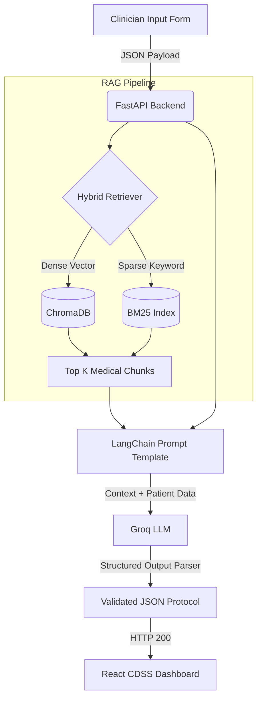

# 🩺 Precision Oncology CDSS (Clinical Decision Support System)

<div align="center">
  
  
  
  
  
</div>

<br />

An advanced, AI-driven **Clinical Decision Support System (CDSS)** engineered for precision oncology. This project utilizes a sophisticated **Retrieval-Augmented Generation (RAG)** pipeline to synthesize evidence-based, NCCN-aligned treatment protocols tailored to a patient's exact clinical profile (e.g., Oncogenic drivers, PD-L1 expression, ECOG status, and comorbidities).

---

## ✨ Features

- **Hybrid Search RAG Pipeline**: Combines dense semantic search (ChromaDB + HuggingFace Embeddings) with sparse keyword search (BM25) to guarantee highly accurate medical guideline retrieval.
- **Explainable AI**: Outputs detailed clinical rationales, concrete citations, and second-line alternatives for every recommendation, preventing black-box AI behavior.
- **Precision Oncology Focus**: Specifically tuned for Non-Small Cell Lung Cancer (NSCLC) integrating complex biomarkers (EGFR, ALK, ROS1, PD-L1) and organ-specific safety alerts (eGFR, Hepatic Impairment).
- **Automated Pipeline Evaluation**: Integrated with **Ragas** to score RAG metrics like *Faithfulness*, *Answer Relevancy*, *Context Precision*, and *Context Recall*.
- **Modern Healthcare Dashboard**: A stunning, responsive React frontend powered by Tailwind CSS v4, providing an intuitive workflow for clinicians.

---

## 🏗️ System Architecture



---

## 💻 Tech Stack

### **Backend (Data & AI Layer)**
- **Python 3.12**
- **FastAPI** + **Uvicorn**
- **LangChain** (Orchestration & Structured Output Parsers)
- **Groq** API (LLM Engine: `openai/gpt-oss-20b` / `llama-3.3-70b-versatile`)
- **ChromaDB** & **BM25Retriever** (Hybrid Vector Store)
- **HuggingFace** (`BAAI/bge-base-en-v1.5` for state-of-the-art medical embeddings)
- **Ragas** (Evaluation & Benchmarking)

### **Frontend (UI/UX Layer)**
- **React** (Vite)
- **Tailwind CSS v4** (Modern Utility-first styling)
- **Lucide React** (Medical iconography)

---

## 🚀 Getting Started

### 1. Prerequisites
Ensure you have **Python 3.10+** and **Node.js 18+** installed on your system.
You will also need a Groq API Key to power the LLM.

### 2. Backend Setup
Clone the repository and set up your virtual environment:
```bash
# Initialize Virtual Environment
python -m venv venv
source venv/Scripts/activate  # On Windows: venv\Scripts\activate

# Install Python dependencies
pip install -r requirements.txt
```

Set up your environment variables:
Create a `.env` file in the root directory and add:
```env
GROQ_API_KEY=your_api_key_here
```

### 3. Frontend Setup
```bash
# Navigate to the frontend directory
cd frontend

# Install Node dependencies
npm install

# Start the React development server
npm run dev
```

### 4. Running the Application
To run the backend server (ensure your virtual environment is active):
```bash
uvicorn app.api:app --reload --port 8000
```
Open your browser and navigate to `http://localhost:5173` to access the CDSS Dashboard.

---

## 📂 Project Structure

```text
📦 CDSS
 ┣ 📂 app
 ┃ ┣ 📜 api.py              # FastAPI application and RAG endpoints
 ┃ ┗ 📜 main.py             # CLI runner for the RAG pipeline
 ┣ 📂 data                  
 ┃ ┗ 📂 raw                 # Raw NCCN Guidelines PDFs
 ┣ 📂 eval
 ┃ ┣ 📜 evaluate.py         # Ragas automated evaluation script
 ┃ ┗ 📜 lung_cancer_test_set.csv # Ground truth dataset for eval
 ┣ 📂 frontend              # React (Vite) Application
 ┃ ┣ 📂 src
 ┃ ┃ ┣ 📜 App.jsx           # Main CDSS Dashboard UI
 ┃ ┃ ┗ 📜 index.css         # Tailwind v4 imports
 ┃ ┣ 📜 package.json
 ┃ ┗ 📜 vite.config.js
 ┣ 📂 src
 ┃ ┣ 📜 config.py           # Core configurations (Chunk size, Vector DB paths)
 ┃ ┣ 📜 data_loader.py      # PDF parsing and document chunking
 ┃ ┗ 📜 llm_engine.py       # Hybrid Retriever setup & LangChain integration
 ┣ 📜 requirements.txt      # Python dependencies
 ┗ 📜 README.md             # This file
```

---

## 🔬 Evaluation & Metrics

This system uses **Ragas** for continuous evaluation of the RAG pipeline. The evaluation dataset comprises real-world clinical vignettes tested against the generated protocols.
Run the evaluation script to generate `evaluation_results.csv`:
```bash
python eval/evaluate.py
```
**Key Metrics Tracked:**
- **Faithfulness**: Ensures the AI doesn't hallucinate outside the retrieved medical guidelines.
- **Answer Relevancy**: Checks if the protocol directly addresses the patient's specific mutations and comorbidities.

---
*Built for Precision Oncology and Evidence-Based Medicine.* 🧬
